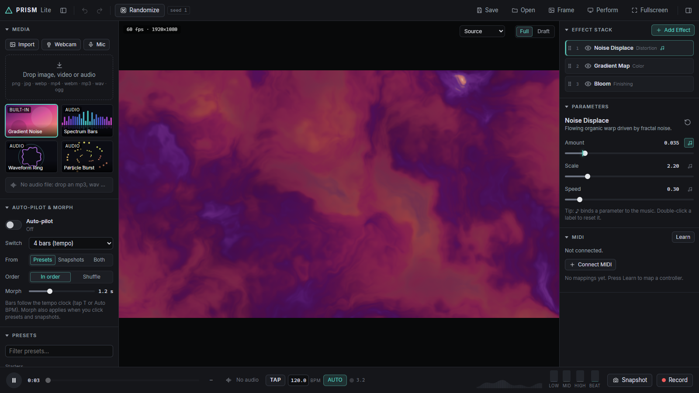

# PRISM Lite

A browser-based, music-reactive visual effects studio. Import an image, video or webcam feed, stack GPU shader effects, bind any parameter to the music, save looks, and export WebM video. It runs entirely in the browser, with no backend. It is built with Vite, TypeScript and raw WebGL2, and has no runtime dependencies.

**Try it live: [mariobilly.github.io/prism-lite](https://mariobilly.github.io/prism-lite/)** (nothing is uploaded; your files stay in your browser)



## Run

```bash
git clone https://github.com/mariobilly/prism-lite.git
cd prism-lite
npm install
npm run dev      # http://localhost:5180
npm run build    # type-check + production build into dist/
npm run preview  # serve the production build
```

Use a current Chrome or Edge. Firefox works too, and Safari works except for video export. WebGL2 is required.

## Using it

| Action | How |
| --- | --- |
| Load media | Drag files anywhere, or use **Import**. Supports png/jpg/webp, mp4/webm, mp3/wav/ogg and `.prism.json` |
| Webcam / mic | **Webcam** and **Mic** buttons in the Media panel |
| Play / pause | `Space` |
| Fullscreen viewer | `F` |
| Perform mode | `P` |
| Auto-pilot on/off | `A` |
| Tap tempo | `T` (or the TAP button) |
| Recall snapshot | `1`–`8` |
| A/B (show source) | Hold `\` |
| Undo / redo | `Ctrl/Cmd+Z`, `Shift+Ctrl/Cmd+Z` (or `Ctrl+Y`) |
| Modulate a parameter | Click ♪ next to it. Pick a music source (Low / Mid / High / Energy / Beat / Tempo) or an LFO (Sine / Tri / Square / Saw / Random). LFOs run at a rate in Hz, or can be synced to the tempo (1/4–16 beats per cycle) |
| Reframe for social | Pick a framing top-right of the viewer (16:9, 9:16, 1:1, 4:5), then drag the image to choose the crop |
| Reset a parameter | Double-click its label |

**Built-in sources:**
- Gradient Noise
- Spectrum Bars
- Waveform Ring
- Particle Burst

The last three react to audio and animate gently when nothing is playing. The **Audio Visualizer** effect layers the same visuals over any image or video.

**Auto-pilot & Morph** (left panel) switches looks automatically. You set how often (every 4–64 beats, or 5–60 seconds), whether it picks from presets, snapshots or both, and whether it goes in order or shuffles. The Morph time also applies when you click a preset or snapshot:
- **Same effects, different settings:** parameters glide to their new values, and feedback trails carry on.
- **Different effects:** the old look crossfades into the new one.

If no beats have been detected for a couple of seconds, beat-based timing falls back to 120 BPM.

**Effects (27):**

| Category | Effects |
| --- | --- |
| Color | Color Adjust, Gradient Map, Hue Cycle |
| Distortion | Noise Displace, Ripple, Kaleidoscope, Swirl, Lens Warp, Mirror / Tile, Tunnel |
| Stylize | Glowing Edges, Pixelate, Halftone, Posterize, Glitch Blocks, Dither, Crystallize |
| Finishing | Bloom, RGB Split, Film Grain, Zoom Blur, CRT Screen, Beat Strobe |
| Generate | Starfield, Light Leaks, Audio Visualizer |
| Temporal | Feedback Trails |

**Tempo** (bottom bar): TAP, type a BPM, or turn on AUTO to follow the detected beat of the music (it phase-locks to the kicks). Click the bar.beat readout to re-align beat 1. Tempo-synced LFOs, the *Tempo* pulse source and auto-pilot's "N bars" timing all use this clock.

**MIDI** (right panel, Chrome or Edge):
1. Click **Connect MIDI**, then **Learn**.
2. Click a target: any parameter slider, a snapshot slot, a preset, TAP, Play or the Auto-pilot switch.
3. Move a knob or hit a pad on the controller.

Knobs sweep a parameter across its range. Pads jump it to maximum while held, and trigger snapshots, presets and actions. A mapping on a parameter follows the first effect of that type in the stack, so it keeps working when you change presets. MIDI moves can be undone. Mappings are saved in the browser and in project files.

**Record** opens the export dialog. You can pick:
- **Framing:** Source, 16:9, 9:16, 1:1 or 4:5.
- **Resolution:** 720p, 1080p or source. This sets the short side, so 9:16 at 1080p is 1080×1920.
- **Duration:** until you stop, or the length of the audio file (the audio restarts from 0:00).
- **Format:** WebM (VP9 + Opus), or MP4 (H.264 + AAC) where the browser supports it.

## Code layout

```
src/
  main.ts            app wiring, render loop, recording, project load/save
  app.ts             AppContext / ViewState types shared by the UI
  engine/
    gl.ts            shader/program/framebuffer helpers
    shaders.ts       vertex shader, shared GLSL header + helpers, procedural source
    audioVisuals.ts  GLSL for spectrum / waveform / particles + the audio-reactive sources
    pipeline.ts      Renderer: source → ping-pong effect chain → screen; feedback buffers
    source.ts        MediaLibrary (built-in / image / video / webcam) + file classification
    recorder.ts      MediaRecorder wrapper (canvas.captureStream + audio track)
    webmDuration.ts  writes the missing Duration into recorded WebM files
  effects/
    types.ts         EffectDef / ParamDef
    registry.ts      list of all effects
    *.ts             one file per effect
  audio/
    analyzer.ts      AudioEngine: <audio> element, mic, AnalyserNode, bands + beat
    modulation.ts    base value + music/LFO modulation per parameter, per frame
    tempo.ts         tempo clock: tap, typed BPM, auto BPM + phase lock from detected beats
  midi/
    midi.ts          Web MIDI input, learn mappings, targets
  state/
    store.ts         effect stack, actions, undo integration, randomize
    undo.ts          history of serialized states
    presets.ts       built-in presets + localStorage user presets
    snapshots.ts     8 snapshot slots
    projectIO.ts     .prism.json save/load
    prng.ts          seeded PRNG (mulberry32)
  ui/                panels, popovers, transport, keyboard, toasts, auto-pilot
```

## Adding an effect

1. Create `src/effects/myEffect.ts`:

```ts
import type { EffectDef } from './types';

export const myEffect: EffectDef = {
  id: 'myEffect',
  name: 'My Effect',
  category: 'Stylize',               // Color | Distortion | Stylize | Finishing | Generate | Temporal
  description: 'One line shown in the Add Effect menu.',
  tags: ['glow', 'retro'],           // extra search words
  params: [
    { key: 'amount', label: 'Amount', min: 0, max: 1, default: 0.5, step: 0.01, rand: [0.2, 0.8] },
  ],
  shader: /* glsl */ `
void main() {
  vec3 c = texture(uInput, vUv).rgb;
  fragColor = vec4(mix(c, 1.0 - c, u_amount), 1.0);
}`,
};
```

2. Add it to the `EFFECTS` array in `src/effects/registry.ts`.

That's all. The UI, randomize, music bindings, presets and project files pick it up automatically.

Inside the shader:

- Each parameter is available as `uniform float u_<key>`.
- Every shader also gets `uInput`, `uResolution`, `uTime`, `uSeed`, `uLow`, `uMid`, `uHigh`, `uEnergy` and `uBeat`.
- `uFlow` is a clock that runs faster when the music is louder.
- `uAudio` is a 256×2 texture: row 0 holds the log spectrum and row 1 the waveform. Prepend `AV_GLSL` from `engine/audioVisuals.ts` to use `specAt`, `waveAt`, `starfield` and friends.
- Shared helpers include `fbm`, `gnoise`, `hash12`, `luma`, `rgb2hsv`, `hsv2rgb`, `mirrorUv`, `aspect` and `rot2` (see `engine/shaders.ts`).

Optional flags:

- `needsMips: true` gives you a mip chain on `uInput`, so `textureLod` can do cheap wide blurs. Bloom and Glowing Edges use it.
- `feedback: true` gives the effect a persistent buffer of its own previous output, bound as `uPrev`, plus a Reset Feedback button.

## License

[MIT](LICENSE)
